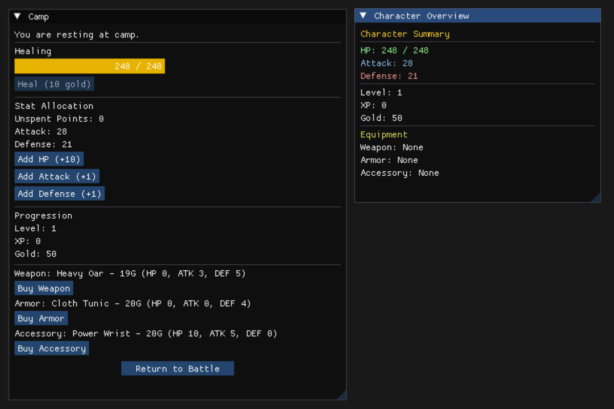
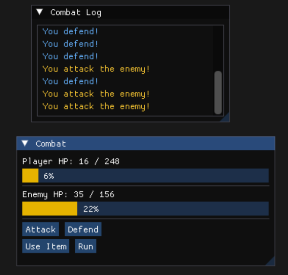

# 100 Battles

<div style="display: flex; gap: 20px; justify-content: center;">
  
  
</div>

## Artifact Summary

100 Battles is a single-player, turn-based RPG developed in modern C++ that challenges players to survive a 
gauntlet of one hundred battles through strategic character building, equipment selection, and risk management. 
Players begin each run by selecting from procedurally generated character options, drafting their starting 
equipment, and choosing how aggressively to progress through battle streaks. The game's core combat system 
revolves around momentum-based mechanics that reward offensive and defensive commitments while creating 
meaningful risk-versus-reward decisions throughout each run.

The project began as a small programming exercise focused on learning data structures, inline initialization, 
and character statistics. Early versions consisted of simple player and enemy structures that could attack, 
defend, and grow stronger over time. As new systems were introduced, including equipment, procedural content 
generation, and data loading, the project naturally expanded beyond its original scope. What started as a 
console-based experiment evolved into a fully playable game featuring a graphical interface, multiple game 
states, SQLite-backed content management, and a modular architecture consisting of more than thirty source files.

Today, 100 Battles serves as both a playable game and a demonstration of modern C++ development practices. 
The project incorporates object-oriented design, database integration, procedural generation, state-driven 
menu systems, combat algorithms, and graphical user interface development through SDL2 and Dear ImGui. 
While still actively developed, the project demonstrates the progression from foundational programming 
concepts to the design of a complete software system with interconnected gameplay, user interface, and 
data management subsystems.

What makes this project particularly meaningful is that it was not built to satisfy a course requirement or 
follow a predefined specification. Instead, each subsystem emerged from curiosity and experimentation. 
As new technical challenges appeared, the project expanded to accommodate them, transforming a simple 
combat simulator into a feature-rich RPG that continues to evolve alongside my skills as a software developer.
Ongoing development has further expanded the project into areas such as cross-platform development, CMake build 
automation, Docker containerization, and Linux deployment, providing valuable experience in software engineering 
practices beyond gameplay programming alone.

---

## Current Architecture

100 Battles is organized into a collection of specialized systems that separate gameplay logic, data management, 
combat processing, and user interface concerns. Rather than placing all functionality inside a single game loop, 
responsibilities are distributed across dedicated classes that communicate through the GameEngine.
At the center of the application is the GameEngine, which acts as the primary coordinator for gameplay flow. 
The GameEngine is responsible for creating and loading the game world, managing state transitions, routing player 
actions, generating store inventories, handling purchases, and controlling the progression between character 
selection, camp, battle preparation, combat, and post-combat rewards.

The CombatEngine manages turn-based encounters. It calculates damage, processes attack and defense actions, 
controls enemy turns, applies rewards, manages combat state transitions, and determines victory or defeat 
conditions. Combat mechanics are further supported by the EnemyAI subsystem, which selects enemy actions based 
on personality-driven behaviors.

Persistent game content is managed through the DatabaseManager, which loads enemies and items from a SQLite 
database into memory at runtime. This approach separates content from implementation, allowing game balancing 
and content updates without requiring direct code changes. The ItemFactory builds item objects from loaded data, 
creating weapon, armor, and accessory instances used throughout the game.

Character progression is handled through the Player system, which manages character statistics, equipment, 
leveling, experience gains, health recalculation, and stat allocation. Supporting utility systems such as the 
Random class provide centralized random number generation for gameplay and procedural content.

The user interface is implemented through SDL2 and Dear ImGui. Rather than using a single monolithic interface, 
each major game state is represented by a dedicated UI component. Separate interfaces exist for the Main Menu, 
Character Selection, Character Confirmation, Camp, Combat, Battle Selection, Character Overview, Debug Tools, 
and Death Summary screens. These elements are coordinated through the UIRouter, which directs rendering to the 
appropriate screen based on the current game state.

This architecture currently spans more than thirty source files and reflects the project's evolution from a 
simple combat experiment into a structured software project containing gameplay systems, database integration, 
procedural generation, graphical user interfaces, state management, and cross-platform build support.


---


## Code Excerpts

<details markdown="1">
<summary><strong>GameEngine.cpp</strong></summary>


The GameEngine acts as the central coordinator for gameplay flow. While systems such as combat, database access, item creation, and UI rendering are implemented in separate components, the GameEngine manages their interactions and controls progression through the game's major states.

**World Initialization**
```cpp

void GameEngine::loadWorld()
{
    enemies = db->loadEnemies();
    items = std::move(db->loadItems());

    weaponPool.clear();
    armorPool.clear();
    accessoryPool.clear();

    for (auto& [id, ptr] : items) {
        if (auto w = dynamic_cast<Weapon*>(ptr.get()))
            weaponPool.push_back(w);
        else if (auto a = dynamic_cast<Armor*>(ptr.get()))
            armorPool.push_back(a);
        else if (auto ac = dynamic_cast<Accessory*>(ptr.get()))
            accessoryPool.push_back(ac);
    }
}

```

**Concepts Demonstrated** 
- database integration 
- polymorphism 
- initialization of runtime game data

---

**Character Generation**
```cpp

void GameEngine::startNewGame()
{
    currentEnemy = nullptr;
    combatEngine.reset();

    player1 = std::nullopt;

    warriorRoll = RolledArchetype{
        Archetype::Warrior,
        Stats{ roll(200,260), roll(20,40), roll(20,30) }
    };

    rogueRoll = RolledArchetype{
        Archetype::Rogue,
        Stats{ roll(140,200), roll(30,50), roll(30,40) }
    };

    mageRoll = RolledArchetype{
        Archetype::Mage,
        Stats{ roll(170,230), roll(40,60), roll(10,20) }
    };

    state = GameState::CharacterSelection;
}

```

**Concepts Demonstrated** 
- procedural generation
- game initialization
- state management

---

**Battle Streak Progression**
```cpp

void GameEngine::updateCombat()
{
    if (!combatEngine.isCombatOver())
        return;

    if (combatEngine.playerDied())
    {
        state = GameState::DeathSummary;
        uiState = UIState::DeathSummary;
        return;
    }

    if (--streakRemaining > 0)
    {
        startCombat();
    }
    else
    {
        enterCamp();
    }
}

```

**Concepts Demonstrated** 
- gameplay flow
- state transitions
- implementation of the game's core risk-versus-reward battle streak system

---
</details>

<details markdown="1">
<summary><strong>CombatEngine.cpp</strong></summary>

The CombatEngine is responsible for resolving turn-based encounters, processing player and enemy actions, applying rewards, and maintaining combat state. One of its primary mechanics is the momentum system, which rewards repetitive offensive or defensive behavior through special combat states.

**Momentum State System**
```cpp

void CombatEngine::updateCombatState(
    CombatState& state,
    bool didAttack,
    bool didDefend)
{
    if (didAttack) {
        state.attacksInRow++;
        state.defendsInRow = 0;

        if (state.attacksInRow == 3) {
            state.isAgro = true;
            state.isNextAttackAgro = true;
            state.attacksInRow = 0;
        }
    }
    else if (didDefend) {
        state.defendsInRow++;
        state.attacksInRow = 0;

        if (state.defendsInRow == 3) {
            state.isTranquil = true;
            state.isNextAttackTranquil = true;
        }
    }
}

```

This excerpt implements one of the game's core mechanics. Consecutive attacks build momentum toward an Agro state, while consecutive defensive actions build momentum toward Tranquil.
Agro rewards aggressive play by enhancing the next attack, while Tranquil imposes a penalty by skipping the next turn. Because both the player and enemy use this same system, combat becomes a balance between immediate actions and long-term consequences. This approach transforms combat from a simple exchange of attacks into a system of strategic timing and risk management.


**Concepts Demonstrated** 
- State Machines
- Algorithm Design
- Gameplay Systems
- Risk vs Reward Mechanics
- Encapsulation

---

**Damage Resolution**
```cpp

int CombatEngine::calculateDamage(
    const Stats& attackerStats,
    int defenderDefense,
    bool defenderDefending,
    int defendsInRow,
    bool attackerAgro,
    bool defenderAgroFlag)
{
    float defenseMultiplier =
        defenderAgroFlag ? 0.5f : 1.0f;

    float dmgMultiplier = std::max(
        0.0f,
        1.0f - (defenderDefense * defenseMultiplier) * 0.01f
    );

    if (defenderDefending) {
        if (defendsInRow == 1)
            dmgMultiplier *= 0.5f;
        else if (defendsInRow >= 2)
            dmgMultiplier = 0.0f;
    }

    int dmgTotal =
        roll(attackerStats.attack * 0.9,
             attackerStats.attack * 1.1)
        * dmgMultiplier;

    if (attackerAgro)
        dmgTotal *= 2;

    return dmgTotal;
}

```

This function determines the final damage dealt during combat. Damage calculation considers character attack strength, defensive statistics, defensive stance, momentum states, and a controlled random variation. This creates combat encounters that remain somewhat unpredictable while still rewarding strategic decisions and character progression.
The damage algorithm was intentionally structured as a reusable function so that both the player and enemy operate under identical combat rules. This helps maintain combat consistency and simplifies balancing efforts as new content is added.

**Concepts Demonstrated** 
- Combat Algorithms
- Mathematical Modeling
- Reusable Function Design
- Balancing Systems
- Symmetrical Game Rules

---
</details>

<details markdown="1">
<summary><strong>DatabaseManager.cpp</strong></summary>
  
```cpp

while ((rc = sqlite3_step(stmt)) == SQLITE_ROW) {
    int id = sqlite3_column_int(stmt, 0);

    std::string type =
        sqlite3_column_type(stmt, 1) == SQLITE_NULL ? "" :
        reinterpret_cast<const char*>(sqlite3_column_text(stmt, 1));

    std::string name =
        sqlite3_column_type(stmt, 2) == SQLITE_NULL ? "" :
        reinterpret_cast<const char*>(sqlite3_column_text(stmt, 2));

    Stats stats;
    stats.attack = sqlite3_column_int(stmt, 3);
    stats.defense = sqlite3_column_int(stmt, 4);
    stats.health = sqlite3_column_int(stmt, 5);

    auto item = ItemFactory::createItem(
        type,
        id,
        name,
        stats,
        element,
        rarity,
        min_level,
        max_level);

    items.emplace(id, std::move(item));
}

```

This excerpt demonstrates how game content is loaded from SQLite and transformed into runtime objects. Rather than hardcoding every weapon, armor piece, and accessory directly into source code, item data is stored within database tables and loaded during startup.

Each database row is converted into a structured set of statistics before being passed to the ItemFactory. The factory then constructs the appropriate object type and stores it within the game's item collection.

Moving content into SQLite significantly improved maintainability and scalability. New items can be created, balanced, or removed by modifying database records rather than recompiling the application. This separation between game data and gameplay logic allows content development and system development to evolve independently.

**Concepts Demonstrated**

- SQLite Integration
- Data-Driven Design
- Runtime Object Construction
- Factory Pattern Integration
- Smart Pointer Ownership (std::unique_ptr)
- Separation of Data and Logic

---
</details>

<details markdown="1">
<summary><strong>ItemFactory.cpp</strong></summary>
  
```cpp
  
std::unique_ptr<Item> ItemFactory::createItem(
    const std::string& type,
    int id,
    const std::string& name,
    const Stats& stats,
    const std::string& element,
    int rarity,
    int min_level,
    int max_level)
{
    if (type == "weapon")
        return std::make_unique<Weapon>(
            id, name, stats, element,
            rarity, min_level, max_level);

    else if (type == "armor")
        return std::make_unique<Armor>(
            id, name, stats, element,
            rarity, min_level, max_level);

    else if (type == "accessory")
        return std::make_unique<Accessory>(
            id, name, stats, element,
            rarity, min_level, max_level);

    throw std::runtime_error("Unknown item type: " + type);
}

```

This excerpt demonstrates the ItemFactory, which is responsible for creating all equipment objects used throughout the game. Item definitions are loaded from SQLite and routed through a single creation 
point that determines whether the resulting object should be a Weapon, Armor, or Accessory.

By centralizing object construction, the rest of the codebase does not need to know how individual item types are instantiated. Systems such as inventory management, character equipment, store generation, 
and loot rewards can request items through the factory rather than creating them directly. This approach improves maintainability and reduces coupling between gameplay systems.

The function also demonstrates the use of modern C++ memory management through std::unique_ptr, ensuring that dynamically created items are automatically cleaned up without requiring manual memory management.

**Concepts Demonstrated**

- Factory Pattern
- Polymorphism
- Modern C++ Smart Pointers (std::unique_ptr)
- Separation of Concerns
- Database-Driven Content Creation

</details>

---

## Development Journal Highlights

**Architecture Evolution**

As the project grew, it became increasingly difficult to manage gameplay logic inside a handful of classes. New systems such as combat, item generation, UI rendering, and database access introduced competing responsibilities that made the code harder to reason about. This led me to refactor the application into specialized components including GameEngine, CombatEngine, DatabaseManager, ItemFactory, and UIRouter. The experience taught me that architecture is not something added at the end of a project; it emerges when complexity forces developers to organize responsibilities explicitly.

**State Management**

Converting the project from a collection of menus into a cohesive game required thinking in terms of state transitions. Introducing GameState and UIState allowed gameplay progression and user interface navigation to evolve independently. This change reduced coupling between systems and clarified how players move through the application. Building these transitions helped me appreciate that managing state is one of the most important design challenges in interactive software.

**Cross-Platform Development**

A major milestone occurred when I decided to move beyond local Visual Studio builds and treat the project like software intended for distribution. The migration to GitHub introduced version control discipline, while CMake and GitHub Actions allowed the project to be built automatically across multiple platforms. Identifying and resolving platform-specific build issues demonstrated the value of automated validation and reinforced the importance of reproducible build environments. This phase expanded my understanding of software engineering beyond writing code and into the realities of deployment, portability, and maintenance.

**Reproducible Environments**

As development expanded across different systems, I began exploring Docker to create reproducible runtime environments. This introduced challenges involving SDL2, graphical applications, Linux display servers, and containerized execution. Working through these issues taught me how software behaves differently across environments and why reproducibility matters. The experience reinforced the idea that shipping software requires more than writing functionality; it also requires ensuring that functionality can run consistently on machines other than your own.

**From Program to Product**

One of the most significant lessons from 100 Battles was realizing the difference between a program and a product. Early versions focused entirely on functionality. As the project matured, issues such as interface clarity, feedback visibility, menu navigation, testing, documentation, and deployment became equally important. Building a playable experience required considering how users interact with the software, not just how the software executes code.


---

## Future Roadmap 

Although 100 Battles currently provides a playable game loop featuring character selection, combat, equipment, progression, database-driven content, and a graphical user interface, several major systems remain under active development. Future work will primarily focus on expanding gameplay depth, improving player feedback, and preparing the project for wider distribution.

### Gameplay Systems

**Item Usage & Inventory Expansion:**
The current architecture supports weapons, armor, and accessories, but active item usage remains a placeholder system. Future development will introduce consumables, combat items, and temporary status effects to create additional tactical choices during encounters.

**Economy and Store Improvements:**
The store currently supports equipment generation and purchasing. Future enhancements include item selling, expanded inventory management, dynamic pricing, and a broader reward structure tied to battle streak performance and player progression.

**Character Progression:**
The existing leveling system provides a foundation for long-term character growth. Future iterations will explore additional progression systems, expanded stat customization, and build-defining choices that further differentiate archetypes and playstyles.

---

### Combat and Balancing

**Momentum System Refinement:**
The Agro and Tranquil mechanics are functional but require additional playtesting and balancing. Future work will focus on ensuring these systems create meaningful strategic decisions without encouraging repetitive or dominant play patterns.

**Enemy Variety:**
The current enemy system supports database-driven encounters and reward generation. Additional enemies, abilities, elemental interactions, and AI behaviors will further increase encounter diversity and replayability.

**Difficulty Tuning:**
As more content is added, combat pacing, reward scaling, healing costs, and battle streak risk calculations will be refined to better support the core risk-versus-reward gameplay loop.

---

### Technical Enhancements

**Test Coverage Expansion:**
Initial Catch2 testing has demonstrated the value of automated validation. Future development will continue increasing test coverage across combat systems, progression mechanics, database loading, and gameplay edge cases.

**Cross-Platform Distribution:**
Recent work with CMake, GitHub Actions, Docker, Linux builds, and macOS validation established a foundation for portable deployment. Future goals include streamlined builds, automated release workflows, and simplified installation instructions for players.

**Save and Load Support:**
Future versions may include persistent save files, allowing players to pause and resume long-term runs while preserving progression and inventory state.

---

### User Experience

**Combat Feedback:**
Additional visual and textual feedback will improve combat readability by making momentum states, damage calculations, rewards, and status changes easier for players to understand.

**Interface Polish:**
Future UI updates will focus on clarity, accessibility, layout refinement, and overall presentation quality as the project moves toward a beta release.

**Code Review and Documentation:**
Once core gameplay systems stabilize, a formal code review walkthrough will be added to this portfolio artifact. The review will highlight key architectural decisions, database integration, combat mechanics, and lessons learned throughout development.

---

### Long-Term Vision
The long-term goal of 100 Battles is not simply to complete a game, but to continue using the project as a platform for learning modern software engineering practices. Each new system provides opportunities to explore architecture, testing, deployment, databases, user experience design, and maintainable code organization within a project I genuinely enjoy building.

---

### Repository

**[View Full Original C++ Project](https://github.com/RPG978/100_Battles.git)**

---

[<- Back to Portfolio](index.md)
